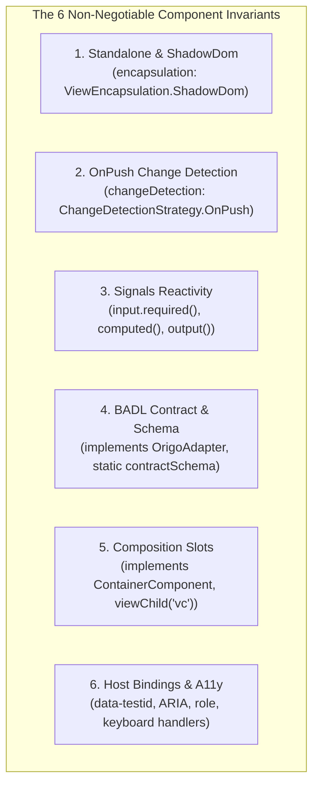

# Component Invariants & Shadow DOM Checklist

**Owner:** Elena (Junior Developer)  
**Contributors:** Charlie (Senior Developer), Amelia (Developer), Patel (Project Lead)  
**Status:** Active Canonical Guide  
**Applies To:** `@origo/angular-renderer`, all UI primitive and layout components  
**Related Architecture Decisions:** `P1-AD-1` (Angular 18 Standalone + Signals), `P1-AD-5` (Composition over Inheritance), `P1-AD-6` (Accessibility Enforcement in CI), `AD-4` (Renderer Isolation), `AD-11` (Telemetry via BADL Semantic Paths), `AD-12` (Test Selectors via metadata_path), `AD-6` (Design Tokens Single Source of Truth)

---

## 1. Executive Overview & Purpose

During Epic 1 development and retrospective analysis (`epic-1-retro-2026-10-11.md`), multiple pull requests encountered preventable review cycles due to architectural omissions:

- Components created without `ViewEncapsulation.ShadowDom`, causing unexpected style bleeding or failure to isolate encapsulated component styles.
- Components omitting `ChangeDetectionStrategy.OnPush`, preventing zoneless change detection and causing wasteful dirty-checking cycles.
- Primitives crashing when consuming dynamic BADL AST nodes because `static readonly contractSchema` was missing or property coercion (`coerceContractProps`) was bypassed.
- Subclassing base components instead of using Angular composition slots (`ContainerComponent`, `viewChild('vc')`, `<ng-content>`), violating `P1-AD-5`.
- Unit test suites bypassing real DOM interactions or failing because assertions queried `fixture.nativeElement` without piercing the component's `shadowRoot`.

This guide establishes the mandatory architectural invariants that every component in `@origo/angular-renderer` must satisfy. Any component submitted for code review that fails to honor these invariants will be rejected.

---

## 2. Architectural Bindings & Standards

All components in `@origo/angular-renderer` operate as the outermost rendering layer for BADL (Business Application Description Language) contracts. They must honor the following architectural decisions defined in the [Phase 1 Architecture Spine](file:///g:/OrigoStudio/Repositories/Origo-Design/origo-design/_bmad-output/planning-artifacts/architecture/architecture-origo-design-2026-07-28/phase1-foundation/ARCHITECTURE-SPINE.md):

### 2.1 P1-AD-1 — Angular 18 Standalone Components & Signals

- **Standalone Mandatory:** Every component MUST specify `standalone: true`. NgModules are strictly prohibited in the renderer package.
- **Signals Reactivity:** State and input propagation MUST use Angular Signals (`input()`, `computed()`, `model()`, `output()`).
- **Zoneless Compatibility:** The renderer must operate without Zone.js. All components MUST specify `ChangeDetectionStrategy.OnPush`.
- **Zero Unmanaged RxJS:** Component-internal reactive pipelines must not create unmanaged subscriptions (`subscribe()`). RxJS is restricted to router and HTTP integration.

### 2.2 P1-AD-5 — Component Composition over Inheritance

- **Zero Component Inheritance:** No renderer component class may extend another component class (`export class FooComponent extends BarComponent` is forbidden).
- **Slot Composition:** Customization and nesting must use Angular content projection (`<ng-content>`), container refs (`viewChild('vc', { read: ViewContainerRef })`), input composition, or `hostDirectives`.
- **Third-Party Extensions:** Extensions must register through the Component Registry (`FR-EXT-002`) rather than subclassing.

### 2.3 P1-AD-6 & AD-11 / AD-12 — Accessibility, Testability & Telemetry

- **WCAG 2.1 AA Floor:** Every primitive must meet WCAG 2.1 AA standards, verified via Playwright component tests running axe-core in CI.
- **Contract Test Selectors:** The host element MUST bind `[attr.data-testid]="contract().id"`.
- **Semantic ARIA:** Components MUST propagate `aria-label`, `aria-describedby`, roles, and keyboard handlers (`(keydown.enter)`, `(keydown.space)`) from contract props.
- **Telemetry Paths:** Telemetry dispatches must use `contract.id` or BADL `metadata_path`—never DOM selectors or CSS classes.

---

## 3. The 6 Non-Negotiable Component Invariants

Every component in `@origo/angular-renderer/src/components/primitives/` must implement all six of the following invariants:



---

### Invariant 1: Standalone & Shadow DOM Encapsulation

Every component decorator must declare `standalone: true` and `encapsulation: ViewEncapsulation.ShadowDom`.

```typescript
@Component({
  selector: 'origo-button',
  standalone: true,
  templateUrl: './button.component.html',
  styleUrls: ['./button.component.scss'],
  changeDetection: ChangeDetectionStrategy.OnPush,
  encapsulation: ViewEncapsulation.ShadowDom,
  host: {
    '[class]': 'computedHostClasses()',
    '[attr.data-testid]': 'contract().id ?? ""',
  },
})
```

#### Why Shadow DOM?

Shadow DOM guarantees that:

1. Styles authored for `@origo/*` primitives never leak out to pollute hosting enterprise applications.
2. Global styles or third-party CSS libraries cannot accidentally override or mutate primitive visuals.
3. CSS Custom Properties (`--origo-*`) penetrate shadow boundaries cleanly while CSS rules remain encapsulated.

#### Required SCSS Scoping (`:host`):

Every component's stylesheet (`.scss`) must define `:host` to control display, box model, and layout boundaries:

```scss
:host {
  display: inline-block; // or block, flex, grid
  box-sizing: border-box;

  *,
  *::before,
  *::after {
    box-sizing: inherit;
  }
}

:host([hidden]) {
  display: none !important;
}

:host([disabled]) {
  cursor: not-allowed;
  pointer-events: none;
}
```

---

### Invariant 2: Zoneless-Compatible Change Detection (`OnPush`)

Every component must explicitly declare `changeDetection: ChangeDetectionStrategy.OnPush`.

```typescript
changeDetection: ChangeDetectionStrategy.OnPush,
```

- Components must never rely on `Default` change detection or Zone.js microtask hooks.
- Because reactivity is powered by Angular Signals, templates automatically re-evaluate when signals change, offering maximum rendering efficiency and zoneless readiness.

---

### Invariant 3: Angular Signals Reactive State Management

All input properties, derived computations, and two-way bindings must use Angular 18 Signal primitives:

```typescript
// 1. Mandatory input contract driving the component
contract = input.required<InteractionContract<ButtonProps>>();

// 2. Two-way model binding (for form controls, text inputs, checkboxes)
value = model<string>('');

// 3. Derived reactive state via computed()
computedLabel = computed(() => this.contract().props?.label ?? 'Button');
computedDisabled = computed(() => {
  const props = this.contract().props;
  const rulesDisable =
    props?.rules?.['disable'] === true || props?.permissions?.['allow'] === 'false';
  return !!props?.disabled || rulesDisable;
});

// 4. Output events via output()
action = output<void>();
```

#### Signal Rules:

- **Never mutate inputs directly:** Derive state with `computed()`.
- **Effects with caution:** Use `effect()` exclusively for side effects (e.g. synchronizing external DOM or dispatching events). Always wrap non-dependency reads in `untracked()`.
- **Zero manual subscriptions:** Never call `.subscribe()` on component observables inside the primitive lifecycle.

---

### Invariant 4: BADL Interaction Contract & Schema Validation

Every primitive component is an adapter for a BADL AST node. The component must:

1. Implement `OrigoAdapter<TProps>`.
2. Define `static readonly contractSchema` declaring expected prop types.
3. Declare `static readonly strictContract = false` (or `true` for strict mode).
4. Utilize `coerceContractProps()` to prevent type coercion runtime exceptions.

```typescript
export interface ButtonProps {
  permissions?: Record<string, string>;
  rules?: Record<string, unknown>;
  metadata?: Record<string, unknown>;
  label?: string;
  disabled?: boolean;
  type?: 'button' | 'submit' | 'reset';
  'aria-label'?: string;
  'aria-describedby'?: string;
  loading?: boolean;
  severity?: string;
  variant?: string;
}

export class ButtonComponent implements OrigoAdapter<ButtonProps> {
  static readonly contractSchema = {
    permissions: 'object',
    rules: 'object',
    metadata: 'object',
    label: 'string',
    disabled: 'boolean',
    type: 'string',
    loading: 'boolean',
    severity: 'string',
    variant: 'string',
  };
  static readonly strictContract = false;

  contract = input.required<InteractionContract<ButtonProps>>();

  protected props = computed(() =>
    coerceContractProps<ButtonProps>(this.contract().props, ButtonComponent.contractSchema)
  );
}
```

#### Why `contractSchema` & `coerceContractProps`?

BADL AST nodes can originate from dynamic JSON definitions, AI generators, or CLI templates. Incoming values might be `"true"` (string) instead of `true` (boolean), or numbers encoded as strings. Declaring `contractSchema` ensures:

- Safe type coercion before template interpolation.
- Zero runtime crashes when optional fields are null or omitted.
- Automatic preservation of `aria-*` and `data-*` properties.

---

### Invariant 5: Container & Slot Composition (`ContainerComponent`)

Components that contain or lay out other BADL nodes (e.g., `Card`, `Container`, `Grid`, `Stack`) must implement `ContainerComponent` and provide both view-container refs and content projection slots.

```typescript
import { OrigoAdapter, ContainerComponent } from '../../../adapters/web/adapter';

export class CardComponent implements OrigoAdapter<CardProps>, ContainerComponent {
  // Target ViewContainerRef for dynamic BADL child instantiation
  vc = viewChild('vc', { read: ViewContainerRef });
  ...
}
```

#### Template Requirements:

The template MUST provide `<ng-container #vc>` for dynamic AST child rendering and `<ng-content>` for direct Angular projection:

```html
<div class="origo-card__content">
  <!-- Dynamic AST child components rendered here by the Experience Adapter -->
  <ng-container #vc></ng-container>
  <!-- Direct template transclusion rendered here -->
  <ng-content></ng-content>
</div>
```

---

### Invariant 6: Host Bindings, Accessibility & Telemetry

Primitives must expose consistent test selectors, ARIA bindings, and telemetry hooks directly on their host element or core interactive child.

```typescript
host: {
  // Testability (AD-12): contract ID mapping
  '[attr.data-testid]': 'contract().id ?? ""',

  // Accessibility (P1-AD-6): ARIA and role reflections
  '[attr.aria-label]': 'computedAriaLabel()',
  '[attr.aria-describedby]': 'computedAriaDescribedBy()',
  '[attr.role]': '"article"',
  '[attr.tabindex]': 'isClickable() ? "0" : null',

  // Keyboard accessibility
  '(keydown.enter)': 'onKeydown($event)',
  '(keydown.space)': 'onKeydown($event)',

  // Dynamic host styling
  '[class.origo-card]': 'true',
  '[class.origo-card--clickable]': 'isClickable()',
}
```

#### Interaction & Telemetry Dispatching:

Interactive primitives must inject `WebExperienceAdapterService` and dispatch capability invocations via `contract.id`:

```typescript
private experienceAdapter = inject(WebExperienceAdapterService);

onClick() {
  if (this.computedDisabled()) return;

  const id = this.contract().id;
  if (id) {
    this.experienceAdapter.dispatchCapability(id, 'click');
  }
  this.action.emit();
}
```

---

## 4. Canonical Golden Component Implementations

### 4.1 Golden Action / Control Primitive (`origo-button`)

#### TypeScript (`button.component.ts`):

```typescript
import {
  Component,
  input,
  output,
  ChangeDetectionStrategy,
  computed,
  ViewEncapsulation,
  inject,
} from '@angular/core';
import { InteractionContract } from '@origostudio/core';
import { OrigoAdapter } from '../../../adapters/web/adapter';
import { WebExperienceAdapterService } from '../../../adapters/web/experience-adapter.service';

export interface ButtonProps {
  permissions?: Record<string, string>;
  rules?: Record<string, unknown>;
  metadata?: Record<string, unknown>;
  label?: string;
  disabled?: boolean;
  type?: 'button' | 'submit' | 'reset';
  'aria-label'?: string;
  'aria-describedby'?: string;
  loading?: boolean;
  severity?: string;
  variant?: string;
  icon?: string;
  iconPosition?: string;
}

@Component({
  selector: 'origo-button',
  standalone: true,
  templateUrl: './button.component.html',
  styleUrls: ['./button.component.scss'],
  changeDetection: ChangeDetectionStrategy.OnPush,
  encapsulation: ViewEncapsulation.ShadowDom,
  host: {
    '[class]': 'computedHostClasses()',
    '[attr.data-testid]': 'contract().id ?? ""',
  },
})
export class ButtonComponent implements OrigoAdapter<ButtonProps> {
  static readonly contractSchema = {
    permissions: 'object',
    rules: 'object',
    metadata: 'object',
    label: 'string',
    disabled: 'boolean',
    type: 'string',
    loading: 'boolean',
    severity: 'string',
    variant: 'string',
    icon: 'string',
    iconPosition: 'string',
  };
  static readonly strictContract = false;

  contract = input.required<InteractionContract<ButtonProps>>();

  computedLabel = computed(() => this.contract().props?.label ?? 'Button');
  computedLoading = computed(() => !!this.contract().props?.loading);
  computedDisabled = computed(() => {
    const props = this.contract().props;
    const rulesDisable =
      props?.rules?.['disable'] === true || props?.permissions?.['allow'] === 'false';
    return !!props?.disabled || this.computedLoading() || rulesDisable;
  });

  computedHostClasses = computed(() => {
    const s = this.contract().props?.severity;
    const v = this.contract().props?.variant;
    return ['origo-button', s ? `origo-severity-${s}` : '', v ? `origo-variant-${v}` : '']
      .filter(Boolean)
      .join(' ');
  });

  computedAriaLabel = computed(() => {
    const label = this.contract().props?.['aria-label'];
    return label ? String(label).trim() : undefined;
  });

  action = output<void>();

  private experienceAdapter = inject(WebExperienceAdapterService);

  onClick() {
    if (this.computedDisabled() || this.computedLoading()) return;

    const id = this.contract().id;
    if (id) {
      this.experienceAdapter.dispatchCapability(id, 'click');
    }
    this.action.emit();
  }
}
```

#### Template (`button.component.html`):

```html
<button
  [type]="contract().props?.type ?? 'button'"
  [disabled]="computedDisabled()"
  [attr.aria-label]="computedAriaLabel()"
  [attr.aria-busy]="computedLoading()"
  (click)="onClick()"
  class="origo-button__native"
>
  @if (computedLoading()) {
  <span class="origo-button__spinner" aria-hidden="true"></span>
  }
  <span class="origo-button__label">{{ computedLabel() }}</span>
</button>
```

#### Stylesheet (`button.component.scss`):

```scss
:host {
  display: inline-block;
  box-sizing: border-box;

  *,
  *::before,
  *::after {
    box-sizing: inherit;
  }
}

.origo-button__native {
  display: inline-flex;
  align-items: center;
  justify-content: center;
  gap: var(--origo-spacing-xs, 4px);
  padding-block: var(--origo-spacing-sm, 8px);
  padding-inline: var(--origo-spacing-md, 16px);
  border-radius: var(--origo-radius-sm, 4px);
  font-family: inherit;
  font-size: var(--origo-font-size-md, 14px);
  background-color: var(--origo-color-surface-primary, #0066ff);
  color: var(--origo-color-text-inverse, #ffffff);
  border: none;
  cursor: pointer;
  transition: background-color var(--origo-motion-duration-fast, 150ms) ease;

  &:hover:not(:disabled) {
    background-color: var(--origo-color-surface-primary-hover, #0052cc);
  }

  &:disabled {
    opacity: var(--origo-opacity-disabled, 0.5);
    cursor: not-allowed;
  }
}
```

---

### 4.2 Golden Container / Layout Primitive (`origo-card`)

#### TypeScript (`card.component.ts`):

```typescript
import {
  Component,
  input,
  ChangeDetectionStrategy,
  computed,
  ViewEncapsulation,
  viewChild,
  ViewContainerRef,
} from '@angular/core';
import { InteractionContract } from '@origostudio/core';
import { OrigoAdapter, ContainerComponent } from '../../../adapters/web/adapter';

export interface CardProps {
  permissions?: Record<string, string>;
  rules?: Record<string, unknown>;
  metadata?: Record<string, unknown>;
  title?: string;
  subtitle?: string;
  elevation?: 'none' | 'sm' | 'md' | 'lg';
  variant?: 'solid' | 'outline' | 'ghost';
  clickable?: boolean;
}

@Component({
  selector: 'origo-card',
  standalone: true,
  templateUrl: './card.component.html',
  styleUrls: ['./card.component.scss'],
  changeDetection: ChangeDetectionStrategy.OnPush,
  encapsulation: ViewEncapsulation.ShadowDom,
  host: {
    '[class.origo-card]': 'true',
    '[attr.data-testid]': 'contract().id ?? ""',
    '[attr.role]': '"article"',
    '[attr.tabindex]': 'isClickable() ? "0" : null',
    '(keydown.enter)': 'onKeydown($event)',
    '(keydown.space)': 'onKeydown($event)',
  },
})
export class CardComponent implements OrigoAdapter<CardProps>, ContainerComponent {
  static readonly contractSchema = {
    permissions: 'object',
    rules: 'object',
    metadata: 'object',
    title: 'string',
    subtitle: 'string',
    elevation: 'string',
    variant: 'string',
    clickable: 'boolean',
  };
  static readonly strictContract = false;

  contract = input.required<InteractionContract<CardProps>>();
  vc = viewChild('vc', { read: ViewContainerRef });

  computedTitle = computed(() => this.contract().props?.title);
  computedSubtitle = computed(() => this.contract().props?.subtitle);
  isClickable = computed(() => !!this.contract().props?.clickable);

  onKeydown(event: Event) {
    if (this.isClickable() && event.target === event.currentTarget) {
      event.preventDefault();
      (event.target as HTMLElement).click();
    }
  }
}
```

#### Template (`card.component.html`):

```html
<div class="origo-card__container">
  @if (computedTitle() || computedSubtitle()) {
  <header class="origo-card__header">
    @if (computedTitle()) {
    <h3 class="origo-card__title">{{ computedTitle() }}</h3>
    } @if (computedSubtitle()) {
    <p class="origo-card__subtitle">{{ computedSubtitle() }}</p>
    }
  </header>
  }

  <section class="origo-card__body">
    <!-- Dynamic child BADL elements attached here -->
    <ng-container #vc></ng-container>
    <!-- Projected DOM nodes -->
    <ng-content></ng-content>
  </section>
</div>
```

---

## 5. Shadow DOM Testing & Piercing Patterns

Because all primitives encapsulate their DOM inside a Shadow Root, standard `fixture.debugElement.query(By.css(...))` will return `null` for elements inside the shadow boundary.

### 5.1 Piercing the Shadow Root (`shadowRoot ?? fixture.nativeElement`)

Always access the component's internal elements via `shadowRoot`:

```typescript
describe('ButtonComponent', () => {
  let fixture: ComponentFixture<ButtonComponent>;
  let componentRef: ComponentRef<ButtonComponent>;

  beforeEach(async () => {
    await TestBed.configureTestingModule({
      imports: [ButtonComponent],
      providers: [WebExperienceAdapterService],
    }).compileComponents();

    fixture = TestBed.createComponent(ButtonComponent);
    componentRef = fixture.componentRef;
  });

  it('should penetrate shadowRoot and render button label', () => {
    // 1. Set Signal inputs via componentRef
    componentRef.setInput('contract', {
      id: 'btn-submit',
      type: 'Button',
      props: { label: 'Save Changes', disabled: false },
    });
    fixture.detectChanges();

    // 2. Safely pierce Shadow DOM boundary
    const root = fixture.nativeElement.shadowRoot ?? fixture.nativeElement;
    const button = root.querySelector('.origo-button__native') as HTMLButtonElement;

    // 3. Assert on real encapsulated DOM nodes
    expect(button).toBeTruthy();
    expect(button.textContent?.trim()).toBe('Save Changes');
    expect(button.disabled).toBe(false);
  });

  it('should dispatch capability on real DOM click', () => {
    const adapter = TestBed.inject(WebExperienceAdapterService);
    const spy = vi.spyOn(adapter, 'dispatchCapability');

    componentRef.setInput('contract', {
      id: 'btn-action',
      type: 'Button',
      props: { label: 'Click Me' },
    });
    fixture.detectChanges();

    const root = fixture.nativeElement.shadowRoot ?? fixture.nativeElement;
    const button = root.querySelector('button') as HTMLButtonElement;
    button.click();

    expect(spy).toHaveBeenCalledWith('btn-action', 'click');
  });
});
```

### 5.2 Key Testing Rules

1. **Never mock away Shadow DOM:** Tests must execute against `ViewEncapsulation.ShadowDom` to catch CSS encapsulation and slot bugs before CI.
2. **Set inputs via `componentRef.setInput()`:** In Angular 18 Signal components, use `fixture.componentRef.setInput('contract', ...)` and call `fixture.detectChanges()`.
3. **Dispatch real events:** Use `element.click()` or `element.dispatchEvent(new Event('input'))` rather than triggering component class methods manually.

---

## 6. Anti-Patterns & Common Pitfalls

| ❌ Anti-Pattern                                                 | Why It Fails                                                                                     | ✅ Standard Pattern                                                                                    |
| --------------------------------------------------------------- | ------------------------------------------------------------------------------------------------ | ------------------------------------------------------------------------------------------------------ |
| **Omitting `encapsulation` or using `Emulated`**                | Violates component isolation. Styles leak out or external styles distort primitives.             | Declare `encapsulation: ViewEncapsulation.ShadowDom` on `@Component`.                                  |
| **Omitting `ChangeDetectionStrategy.OnPush`**                   | Breaks zoneless runtime compatibility. Causes performance degradation in large enterprise forms. | Declare `changeDetection: ChangeDetectionStrategy.OnPush`.                                             |
| **Component Class Inheritance (`class Foo extends Bar`)**       | Tight coupling, fragile base class problem. Violates `P1-AD-5`.                                  | Use composition, slots (`<ng-content>`, `#vc`), and `hostDirectives`.                                  |
| **Missing `contractSchema`**                                    | Unvalidated BADL AST props cause runtime null pointer crashes during dynamic rendering.          | Declare `static readonly contractSchema = { ... }` with explicit types.                                |
| **Unprotected prop access (`this.contract().props.foo`)**       | Fails when `props` is undefined.                                                                 | Use `computed()` with safe navigation: `this.contract().props?.foo ?? fallback`.                       |
| **Using `fixture.debugElement.query()` for shadow nodes**       | Returns `null` because DebugElement does not automatically penetrate Shadow DOM.                 | Use `const root = fixture.nativeElement.shadowRoot ?? fixture.nativeElement; root.querySelector(...)`. |
| **Hardcoding element IDs or CSS classes for telemetry/testing** | Coupling telemetry to DOM internals breaks when layouts change (AD-11/AD-12).                    | Bind `[attr.data-testid]="contract().id"` and use `metadata_path` / `contract().id`.                   |

---

## 7. Developer PR Pre-Flight Checklist

Before opening a pull request for any component in `@origo/angular-renderer`, copy and verify this checklist:

```markdown
### Component Invariants Pre-Flight Checklist

- [ ] **Architecture & Decorator:**
  - [ ] `@Component({ standalone: true })` is declared.
  - [ ] `encapsulation: ViewEncapsulation.ShadowDom` is explicitly configured.
  - [ ] `changeDetection: ChangeDetectionStrategy.OnPush` is explicitly configured.
  - [ ] Component does NOT extend any other component class (`P1-AD-5`).

- [ ] **State & Reactivity (Signals):**
  - [ ] `contract = input.required<InteractionContract<TProps>>()` is present.
  - [ ] All derived state uses `computed()`.
  - [ ] Two-way inputs use `model()`.
  - [ ] No unmanaged RxJS `.subscribe()` calls in component logic.

- [ ] **BADL Contract & Schema:**
  - [ ] Implements `OrigoAdapter<TProps>`.
  - [ ] Defines `static readonly contractSchema` covering all defined props.
  - [ ] Defines `static readonly strictContract = false`.
  - [ ] Uses `coerceContractProps()` or defensive `computed()` fallback logic.

- [ ] **Composition & Slots (if Container):**
  - [ ] Implements `ContainerComponent` (if handling children).
  - [ ] Contains `vc = viewChild('vc', { read: ViewContainerRef })`.
  - [ ] Template includes `<ng-container #vc></ng-container>` and `<ng-content></ng-content>`.

- [ ] **Accessibility & Host Bindings:**
  - [ ] Host binds `[attr.data-testid]="contract().id"`.
  - [ ] Propagates `aria-label`, `aria-describedby`, and semantic roles.
  - [ ] Interactive components implement keyboard navigation (`(keydown.enter)`, `(keydown.space)`).
  - [ ] Dispatches telemetry/capability events via `WebExperienceAdapterService`.

- [ ] **Modular SCSS:**
  - [ ] Stylesheet root defines `:host` display and `box-sizing: border-box`.
  - [ ] Zero hardcoded hex/px values (uses `--origo-*` design tokens per `AD-6`).
  - [ ] Zero physical layout properties (uses CSS Logical Properties per `NFR-I18N-001`).

- [ ] **Unit Tests & Quality:**
  - [ ] Tests pierce shadow boundary: `fixture.nativeElement.shadowRoot ?? fixture.nativeElement`.
  - [ ] Tests use `componentRef.setInput('contract', ...)` for Signal inputs.
  - [ ] Tests verify real DOM event handling without shallow mock shortcuts.
  - [ ] Passes axe-core accessibility audit without AA violations (`P1-AD-6`).
```
