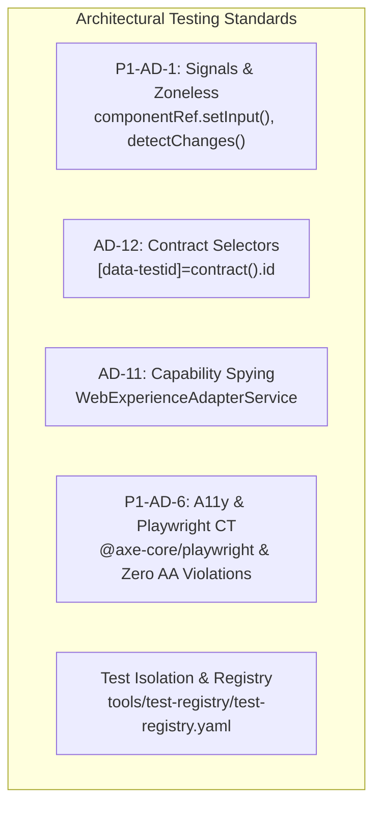

# Test Quality & Shadow DOM Interaction Guide

**Owner:** Dana (QA Engineer)  
**Contributors:** Charlie (Senior Developer), Elena (Junior Developer), Amelia (Developer), Patel (Project Lead)  
**Status:** Active Canonical Guide  
**Applies To:** `@origo/angular-renderer`, all UI primitive and layout components, unit test suites, and Playwright component tests  
**Related Architecture Decisions:** `P1-AD-1` (Angular 18 Standalone + Signals + Zoneless), `P1-AD-6` (Accessibility Enforcement in CI), `AD-11` (Telemetry via BADL Semantic Paths), `AD-12` (Test Selectors via metadata_path), `AD-4` (Renderer Isolation)

---

## 1. Executive Overview & Purpose

During Epic 1 retrospective analysis (`epic-1-retro-2026-10-11.md`), the engineering and QA teams identified significant friction during code reviews caused by superficial and fragile unit test suites:

- **Mocking Internals over Real DOM Events:** Test suites frequently bypassed real DOM interactions, invoking internal component methods directly (e.g. `component.onClick()`) or mocking internal state instead of simulating native browser events on encapsulated DOM nodes. This masked broken template event bindings and prevented verification of disabled states.
- **Shadow DOM Query Failures:** Engineers attempted to query elements using `fixture.debugElement.query(By.css(...))` or standard light-DOM selectors, which return `null` when components enforce `ViewEncapsulation.ShadowDom`.
- **Missed Shadow Event Retargeting & Composition:** Custom and native events dispatched without proper bubbling or composition failed to propagate past shadow boundaries, hiding integration regressions.
- **Omission of Accessibility & Edge Case Scenarios:** Multiple components lacked tests for keyboard navigation (`Enter`, `Space`, `Tab`), focus management across shadow boundaries, defensive handling of null/undefined contracts, and automated axe-core accessibility audits.

This guide establishes the mandatory testing standards and patterns for all UI primitives in `@origo/angular-renderer`. Every pull request in Epic 2 and beyond must adhere to these patterns. Test suites that bypass real DOM interactions or fail isolation requirements will not be approved.

---

## 2. Architectural Testing Standards

All test suites in `@origo/angular-renderer` must align with the foundational architectural decisions established in the [Phase 1 Architecture Spine](file:///g:/OrigoStudio/Repositories/Origo-Design/origo-design/_bmad-output/planning-artifacts/architecture/architecture-origo-design-2026-07-28/phase1-foundation/ARCHITECTURE-SPINE.md):



### 2.1 P1-AD-1 — Angular 18 Signals & Zoneless Change Detection

Components in `@origo/angular-renderer` operate without Zone.js dependencies, relying on Angular Signals (`input()`, `computed()`, `model()`, `output()`) and `ChangeDetectionStrategy.OnPush`.

- **TestBed Configuration:** Provide zoneless change detection where applicable via `provideZonelessChangeDetection()`.
- **Signal Input Propagation:** Set contract inputs via `fixture.componentRef.setInput('contract', contractPayload)` rather than modifying component properties directly.
- **Change Flush:** Always call `fixture.detectChanges()` immediately after setting inputs or dispatching events to flush signal computations into the DOM.

### 2.2 AD-12 — Test Selectors Use BADL `metadata_path` & Contract IDs

- **Stability Invariant:** Test selectors must never couple to internal CSS classes, element tag names, or volatile markup hierarchy.
- **Contract Binding:** The component host element binds `[attr.data-testid]="contract().id"`. Tests and automated E2E harnesses must query components by contract ID or BADL semantic `metadata_path` (FR-TEST-001, FR-TEST-002).
- **Longevity:** A test authored against renderer v1 must continue to pass against future renderer revisions as long as the BADL contract remains unchanged.

### 2.3 AD-11 — Telemetry & Capability Dispatch Verification

- **Stateless Integration:** Primitives do not perform business operations directly. They emit user actions through `WebExperienceAdapterService.dispatchCapability(contractId, actionName)` or `WebExperienceAdapterService.updateState(contractId, propName, value)`.
- **Spying over Mocking:** Tests must inject `WebExperienceAdapterService` and spy on its public API (`dispatchCapability`, `updateState`) to verify that real DOM triggers dispatch the expected payload with the exact `contract().id`.

### 2.4 P1-AD-6 — WCAG 2.1 AA Accessibility Enforcement in CI

- **Dual-Layer Verification:**
  1. **Unit Test Level (Jest):** Verify semantic ARIA attributes (`aria-label`, `aria-describedby`, `role`, `aria-busy`, `tabindex`) and keyboard activation (`(keydown.enter)`, `(keydown.space)`).
  2. **Component Test Level (Playwright CT):** Every primitive must have a companion `.pw.ts` spec that mounts the component with `@jscutlery/playwright-ct-angular` and runs `@axe-core/playwright`.
- **Zero Violations:** CI enforces zero WCAG 2.1 AA violations.

---

## 3. Shadow DOM Boundary Piercing & Querying

When `ViewEncapsulation.ShadowDom` is configured, component markup is rendered inside an isolated `ShadowRoot`. Attempting to query internal nodes from the outer document or via Angular's `DebugElement` will fail.

### 3.1 The Shadow DOM Encapsulation Barrier

```
Light DOM (Host Document)
└── <origo-button data-testid="btn-1"> (fixture.nativeElement)
    └── #shadow-root (open)  <-- BOUNDARY ENCAPSULATION
        └── <button class="origo-button__native"> (Accessible only via shadowRoot)
            └── <span class="origo-button__label">Save</span>
```

- `fixture.debugElement.query(By.css('button'))` searches only light DOM children; it returns `null`.
- `fixture.nativeElement.querySelector('button')` returns `null`.

### 3.2 Canonical Shadow Boundary Piercing Pattern

All unit tests must pierce the shadow boundary using the canonical pattern:

```typescript
// 1. Pierce shadow boundary safely
const root = fixture.nativeElement.shadowRoot ?? fixture.nativeElement;

// 2. Query encapsulated internal nodes
const button = root.querySelector('.origo-button__native') as HTMLButtonElement;
expect(button).toBeTruthy();
expect(button.textContent?.trim()).toBe('Save');
```

> [!IMPORTANT]
> The fallback `?? fixture.nativeElement` ensures robust execution across both standard browser environments and headless/test environments where Shadow DOM polyfills or light-DOM fallbacks may apply, while always asserting against the true `shadowRoot` when present.

### 3.3 Querying Projected Content vs Internal Shadow Nodes

Containers and layout primitives (e.g. `origo-card`, `origo-container`) use Angular content projection (`<ng-content>`) and dynamic view containers (`<ng-container #vc>`):

- **Slotted Content Lives in Light DOM:** Elements projected via `<ng-content>` remain children of the host element in the **light DOM**. They are distributed into `<slot>` elements inside the shadow tree visually, but their DOM parent remains `fixture.nativeElement`.
- **Internal Structural Wrappers Live in Shadow DOM:** Header wrappers, card shells, dividers, and slot placeholders exist inside `shadowRoot`.

```typescript
// Query internal structural wrapper inside Shadow DOM:
const root = fixture.nativeElement.shadowRoot ?? fixture.nativeElement;
const header = root.querySelector('.origo-card__header');

// Query projected content in Light DOM:
const host = fixture.nativeElement as HTMLElement;
const projectedItem = host.querySelector('.user-custom-content');
```

### 3.4 Shadow DOM Focus & `activeElement`

Because of Shadow DOM encapsulation, checking `document.activeElement` when an internal shadow element has focus will return the **host element**, not the focused inner input or button:

```typescript
const root = fixture.nativeElement.shadowRoot ?? fixture.nativeElement;
const innerInput = root.querySelector('input') as HTMLInputElement;
innerInput.focus();

// ❌ Incorrect: document.activeElement stops at the shadow boundary
// expect(document.activeElement).toBe(innerInput); // FAILS! document.activeElement is <origo-text-input>

// ✅ Correct: Check shadowRoot.activeElement for internal focus
expect(root.activeElement).toBe(innerInput);

// ✅ Correct: Check host activeElement from document perspective
expect(document.activeElement).toBe(fixture.nativeElement);
```

---

## 4. Real DOM Event Simulation vs Mocking

The guiding principle for all primitive tests is: **Test Like a User, Not Like a Compiler.**

### 4.1 The Perils of Mocking Component Internals

During Epic 1 reviews, several PRs contained tests like:

```typescript
// ❌ ANTI-PATTERN: Bypassing the DOM completely
it('should handle click', () => {
  const spy = jest.spyOn(component, 'onClick');
  component.onClick(); // Calling TypeScript method directly!
  expect(spy).toHaveBeenCalled();
});
```

**Why this fails:**

1. If the template omitted `(click)="onClick()"`, the test still passes!
2. If the button has `disabled="true"` in the DOM, calling `component.onClick()` still runs the code, completely missing that the browser would prevent the click!
3. If CSS specifies `pointer-events: none` on disabled states, calling methods directly ignores browser behavior.

### 4.2 Simulating Real Browser Events

Always trigger user actions through native browser DOM APIs:

#### 1. Mouse Clicks

```typescript
const root = fixture.nativeElement.shadowRoot ?? fixture.nativeElement;
const button = root.querySelector('button') as HTMLButtonElement;

// Real DOM click simulation
button.click();
fixture.detectChanges();
```

#### 2. Text Input & Data Entry

```typescript
const root = fixture.nativeElement.shadowRoot ?? fixture.nativeElement;
const input = root.querySelector('input') as HTMLInputElement;

input.value = 'New Value';
input.dispatchEvent(new Event('input', { bubbles: true }));
fixture.detectChanges();

expect(component.value()).toBe('New Value');
```

#### 3. Selection Controls (Checkboxes, Switches, Radios)

```typescript
const root = fixture.nativeElement.shadowRoot ?? fixture.nativeElement;
const checkbox = root.querySelector('input[type="checkbox"]') as HTMLInputElement;

checkbox.checked = true;
checkbox.dispatchEvent(new Event('change', { bubbles: true }));
fixture.detectChanges();

expect(component.checked()).toBe(true);
```

#### 4. Keyboard Navigation

```typescript
const host = fixture.nativeElement as HTMLElement;

// Simulating Enter or Space key navigation on interactive host or element
const enterEvent = new KeyboardEvent('keydown', {
  key: 'Enter',
  code: 'Enter',
  bubbles: true,
  composed: true,
});
host.dispatchEvent(enterEvent);
fixture.detectChanges();
```

### 4.3 Event Bubbling & Boundary Composition (`composed: true`)

Events fired inside a Shadow DOM tree do not cross into the light DOM unless configured with `composed: true`:

| Event Type                      | `bubbles`       | `composed`      | Crosses Shadow Boundary?                              |
| ------------------------------- | --------------- | --------------- | ----------------------------------------------------- |
| Native `click`                  | `true`          | `true`          | ✅ Yes                                                |
| Native `input`                  | `true`          | `true`          | ✅ Yes                                                |
| Native `keydown`                | `true`          | `true`          | ✅ Yes                                                |
| Native `focus` / `blur`         | `false`         | `false`         | ❌ No (use `focusin` / `focusout` for composed focus) |
| Standard `CustomEvent`          | default `false` | default `false` | ❌ No (stays confined to shadow tree)                 |
| Boundary-crossing `CustomEvent` | `true`          | `true`          | ✅ Yes                                                |

When dispatching custom events in tests that need to cross shadow boundaries, always specify:

```typescript
const customEvent = new CustomEvent('origo-change', {
  bubbles: true,
  composed: true,
  detail: { value: 42 },
});
element.dispatchEvent(customEvent);
```

---

## 5. Golden Testing Patterns & Reference Suites

Below are canonical, copy-pasteable reference test suites reflecting the exact testing standards of Origo Design.

### 5.1 Golden Pattern 1: Action/Button Primitive (`ButtonComponent`)

```typescript
import { ComponentFixture, TestBed } from '@angular/core/testing';
import { ComponentRef } from '@angular/core';
import { ButtonComponent } from './button.component';
import { WebExperienceAdapterService } from '../../../adapters/web/experience-adapter.service';

describe('ButtonComponent', () => {
  let component: ButtonComponent;
  let fixture: ComponentFixture<ButtonComponent>;
  let componentRef: ComponentRef<ButtonComponent>;
  let experienceAdapter: WebExperienceAdapterService;

  beforeEach(async () => {
    await TestBed.configureTestingModule({
      imports: [ButtonComponent],
      providers: [WebExperienceAdapterService],
    }).compileComponents();

    fixture = TestBed.createComponent(ButtonComponent);
    component = fixture.componentInstance;
    componentRef = fixture.componentRef;
    experienceAdapter = TestBed.inject(WebExperienceAdapterService);
  });

  afterEach(() => {
    jest.restoreAllMocks();
    if (typeof document !== 'undefined') {
      document.body.innerHTML = '';
    }
  });

  it('should initialize and render label from pure JSON contract', () => {
    componentRef.setInput('contract', {
      id: 'btn-save',
      type: 'Button',
      props: { label: 'Save Draft', disabled: false },
    });
    fixture.detectChanges();

    // 1. Pierce Shadow DOM
    const root = fixture.nativeElement.shadowRoot ?? fixture.nativeElement;
    const button = root.querySelector('button') as HTMLButtonElement;

    // 2. Verify encapsulated DOM rendering
    expect(button).toBeTruthy();
    expect(button.textContent?.trim()).toBe('Save Draft');
    expect(button.disabled).toBe(false);

    // 3. Verify stable test selector on host
    expect(fixture.nativeElement.getAttribute('data-testid')).toBe('btn-save');
  });

  it('should dispatch capability on real DOM click', () => {
    const dispatchSpy = jest.spyOn(experienceAdapter, 'dispatchCapability');
    const emitSpy = jest.spyOn(component.action, 'emit');

    componentRef.setInput('contract', {
      id: 'btn-action-1',
      type: 'Button',
      props: { label: 'Submit Form' },
    });
    fixture.detectChanges();

    const root = fixture.nativeElement.shadowRoot ?? fixture.nativeElement;
    const button = root.querySelector('button') as HTMLButtonElement;

    // Simulate real user click
    button.click();

    expect(dispatchSpy).toHaveBeenCalledWith('btn-action-1', 'click');
    expect(emitSpy).toHaveBeenCalled();
  });

  it('should prevent click dispatch when disabled or loading', () => {
    const dispatchSpy = jest.spyOn(experienceAdapter, 'dispatchCapability');

    componentRef.setInput('contract', {
      id: 'btn-disabled',
      type: 'Button',
      props: { label: 'Disabled Button', disabled: true, loading: false },
    });
    fixture.detectChanges();

    const root = fixture.nativeElement.shadowRoot ?? fixture.nativeElement;
    const button = root.querySelector('button') as HTMLButtonElement;
    expect(button.disabled).toBe(true);

    // Clicking disabled button must not dispatch capability
    button.click();
    expect(dispatchSpy).not.toHaveBeenCalled();
  });

  it('should render loading spinner and set aria-busy when loading is true', () => {
    componentRef.setInput('contract', {
      id: 'btn-loading',
      type: 'Button',
      props: { label: 'Processing', loading: true },
    });
    fixture.detectChanges();

    const root = fixture.nativeElement.shadowRoot ?? fixture.nativeElement;
    const button = root.querySelector('button') as HTMLButtonElement;
    const spinner = root.querySelector('.origo-spinner');

    expect(spinner).toBeTruthy();
    expect(button.disabled).toBe(true);
    expect(button.getAttribute('aria-busy')).toBe('true');
  });

  it('should avoid physical CSS properties for RTL compliance (NFR-I18N-001)', () => {
    componentRef.setInput('contract', { id: 'rtl-btn', type: 'Button', props: {} });
    fixture.detectChanges();

    const root = fixture.nativeElement.shadowRoot ?? fixture.nativeElement;
    const element = root.firstElementChild as HTMLElement;
    if (element && element.style) {
      expect(element.style.paddingLeft).toBeFalsy();
      expect(element.style.paddingRight).toBeFalsy();
      expect(element.style.marginLeft).toBeFalsy();
      expect(element.style.marginRight).toBeFalsy();
    }
  });
});
```

---

### 5.2 Golden Pattern 2: Form Input Control Primitive (`TextInputComponent`)

```typescript
import { ComponentFixture, TestBed } from '@angular/core/testing';
import { ComponentRef } from '@angular/core';
import { TextInputComponent } from './text-input.component';
import { WebExperienceAdapterService } from '../../../adapters/web/experience-adapter.service';

describe('TextInputComponent', () => {
  let component: TextInputComponent;
  let fixture: ComponentFixture<TextInputComponent>;
  let componentRef: ComponentRef<TextInputComponent>;
  let experienceAdapter: WebExperienceAdapterService;

  beforeEach(async () => {
    await TestBed.configureTestingModule({
      imports: [TextInputComponent],
      providers: [WebExperienceAdapterService],
    }).compileComponents();

    fixture = TestBed.createComponent(TextInputComponent);
    component = fixture.componentInstance;
    componentRef = fixture.componentRef;
    experienceAdapter = TestBed.inject(WebExperienceAdapterService);
  });

  afterEach(() => {
    jest.restoreAllMocks();
    if (typeof document !== 'undefined') {
      document.body.innerHTML = '';
    }
  });

  it('should synchronize input event and sanitize input payloads', () => {
    const updateStateSpy = jest.spyOn(experienceAdapter, 'updateState');

    componentRef.setInput('contract', {
      id: 'input-username',
      type: 'textInput',
      props: { placeholder: 'Enter username' },
    });
    fixture.detectChanges();

    const root = fixture.nativeElement.shadowRoot ?? fixture.nativeElement;
    const inputElement = root.querySelector('input') as HTMLInputElement;

    // Simulate user typing XSS attempt
    const xssPayload = '<script>alert("xss")</script>validUser';
    inputElement.value = xssPayload;
    inputElement.dispatchEvent(new Event('input', { bubbles: true }));
    fixture.detectChanges();

    // Verify signal state and adapter dispatch
    expect(component.value()).toBe(xssPayload);
    expect(updateStateSpy).toHaveBeenCalledWith('input-username', 'value', xssPayload);
  });

  it('should gracefully handle null/undefined contract props', () => {
    componentRef.setInput('contract', {
      id: 'input-defensive',
      type: 'textInput',
      props: null,
    });
    expect(() => fixture.detectChanges()).not.toThrow();

    const root = fixture.nativeElement.shadowRoot ?? fixture.nativeElement;
    const inputElement = root.querySelector('input') as HTMLInputElement;
    expect(inputElement).toBeTruthy();
    expect(inputElement.value).toBe('');
  });

  it('should propagate aria-describedby and error states', () => {
    componentRef.setInput('contract', {
      id: 'input-field',
      type: 'textInput',
      props: {
        'aria-describedby': 'field-error-msg',
        hasError: true,
      },
    });
    fixture.detectChanges();

    const root = fixture.nativeElement.shadowRoot ?? fixture.nativeElement;
    const inputElement = root.querySelector('input') as HTMLInputElement;

    expect(inputElement.getAttribute('aria-describedby')).toBe('field-error-msg');
    expect(inputElement.getAttribute('aria-invalid')).toBe('true');
  });
});
```

---

### 5.3 Golden Pattern 3: Container / Layout Primitive (`CardComponent`)

```typescript
import { ComponentFixture, TestBed } from '@angular/core/testing';
import { CardComponent } from './card.component';
import { provideZonelessChangeDetection } from '@angular/core';

describe('CardComponent', () => {
  let component: CardComponent;
  let fixture: ComponentFixture<CardComponent>;

  beforeEach(async () => {
    await TestBed.configureTestingModule({
      imports: [CardComponent],
      providers: [provideZonelessChangeDetection()],
    }).compileComponents();

    fixture = TestBed.createComponent(CardComponent);
    component = fixture.componentInstance;
  });

  afterEach(() => {
    jest.restoreAllMocks();
  });

  it('should render card layout and expose ViewContainerRef for dynamic projection', () => {
    fixture.componentRef.setInput('contract', {
      id: 'card-1',
      type: 'Card',
      props: {
        title: 'Project Alpha',
        subtitle: 'Sprint 2',
        elevation: 'md',
      },
    });
    fixture.detectChanges();

    const host = fixture.nativeElement as HTMLElement;
    expect(host.getAttribute('data-testid')).toBe('card-1');

    const root = host.shadowRoot!;
    const title = root.querySelector('.origo-card-title');
    expect(title?.textContent?.trim()).toBe('Project Alpha');

    // Verify ContainerComponent slot interface
    expect(component.vc()).toBeDefined();
  });

  it('should trigger action on keyboard Enter when marked clickable', () => {
    fixture.componentRef.setInput('contract', {
      id: 'clickable-card',
      type: 'Card',
      props: { clickable: true },
    });
    fixture.detectChanges();

    const host = fixture.nativeElement as HTMLElement;
    expect(host.getAttribute('tabindex')).toBe('0');
    expect(host.getAttribute('role')).toBe('article');

    let triggered = false;
    host.addEventListener('click', () => (triggered = true));

    const enterEvent = new KeyboardEvent('keydown', { key: 'Enter', bubbles: true });
    host.dispatchEvent(enterEvent);

    expect(triggered).toBe(true);
  });
});
```

---

### 5.4 Golden Pattern 4: Playwright Component Accessibility Testing (`.pw.ts`)

Every component in `@origo/angular-renderer` must include a companion `.pw.ts` spec executed via `@jscutlery/playwright-ct-angular` and `@axe-core/playwright`.

```typescript
import { test, expect } from '@jscutlery/playwright-ct-angular';
import { ButtonComponent, ButtonProps } from './button.component';
import { InteractionContract } from '@origostudio/core';
import AxeBuilder from '@axe-core/playwright';

test.describe('ButtonComponent Accessibility (WCAG 2.1 AA)', () => {
  test('should pass automated axe accessibility audit without violations', async ({
    mount,
    page,
  }) => {
    // 1. Mount isolated standalone component
    await mount(ButtonComponent, {
      props: {
        contract: {
          id: 'pw-btn-test',
          type: 'Button',
          props: {
            label: 'Accessible Action',
            'aria-label': 'Accessible Action Button',
          },
        } as InteractionContract<ButtonProps>,
      },
    });

    // 2. Run axe scan with document-level container rules disabled
    const accessibilityScanResults = await new AxeBuilder({ page })
      .disableRules([
        'document-title',
        'html-has-lang',
        'landmark-one-main',
        'page-has-heading-one',
        'region',
      ])
      .analyze();

    // 3. Enforce zero violations
    expect(accessibilityScanResults.violations).toEqual([]);
  });
});
```

> [!NOTE]
> The five disabled rules (`document-title`, `html-has-lang`, `landmark-one-main`, `page-has-heading-one`, `region`) apply exclusively to full HTML document bodies. When mounting isolated UI primitives via Playwright CT, these rules must be disabled to prevent false positives while strictly evaluating all element-level rules (contrast, ARIA roles, focus visibility, keyboard navigation, accessible names).

---

## 6. Test Lifecycle, Isolation & Test Registry Hygiene

Per the [Test Isolation Patterns](file:///g:/OrigoStudio/Repositories/Origo-Design/origo-design/tools/test-registry/test-registry.yaml#L15-L20) enforced since Epic 8:

### 6.1 Strict Lifecycle Rules

1. **Scope Mocks in `beforeEach`:** Never define persistent spies or global mocks in `beforeAll` or the file root. Always initialize spies inside `beforeEach`.
2. **Mandatory Teardown in `afterEach`:** Every spec file must include an `afterEach` block:
   ```typescript
   afterEach(() => {
     jest.clearAllMocks();
     jest.restoreAllMocks();
     if (typeof document !== 'undefined') {
       document.body.innerHTML = '';
     }
   });
   ```
3. **Structured Cloning of State:** If test fixtures share mock data or bridge objects, clone them with `structuredClone(payload)` before passing to avoid cyclic mutations across tests.
4. **Clean DOM Reset:** Reset `document.body.innerHTML = ''` to prevent orphaned host elements or overlay containers from bleeding into subsequent test suites.

### 6.2 Central Test Registry Maintenance

Whenever a new `.spec.ts` or `.pw.ts` is created or modified, it must be registered in `tools/test-registry/test-registry.yaml`:

```yaml
- id: renderer-button-primitive
  description: 'Verifies ButtonComponent Shadow DOM rendering, capability dispatch, and tokens'
  package: '@origo/angular-renderer'
  spec_file: packages/angular-renderer/src/components/primitives/button/button.component.spec.ts
  type: unit
  affected_stories:
    - 1-1-core-buttons-and-actions
  last_result: unknown
  results: {}
```

Always validate the registry before opening a pull request:

```bash
npm run validate:registry
```

---

## 7. Anti-Patterns & Common Pitfalls

| ❌ Anti-Pattern                                                                              | Why It Fails                                                                                            | ✅ Standard Pattern                                                                                                   |
| -------------------------------------------------------------------------------------------- | ------------------------------------------------------------------------------------------------------- | --------------------------------------------------------------------------------------------------------------------- |
| **Calling component methods directly (`component.onClick()`)**                               | Bypasses template `(click)` binding, ignores `disabled` attributes, masks syntax errors.                | Simulate real DOM events: `button.click()` or `dispatchEvent(new Event('input'))`.                                    |
| **Using `fixture.debugElement.query(By.css(...))`**                                          | Returns `null` because DebugElement cannot pierce `ViewEncapsulation.ShadowDom`.                        | Pierce shadowRoot: `const root = fixture.nativeElement.shadowRoot ?? fixture.nativeElement; root.querySelector(...)`. |
| **Checking `document.activeElement` for shadow elements**                                    | Returns the host element rather than the inner input or button due to encapsulation.                    | Check `root.activeElement` for internal focused node.                                                                 |
| **Setting component inputs via class properties (`component.contract = ...`)**               | In Angular 18 Signals, `input()` properties are read-only signals; mutating them throws runtime errors. | Use `fixture.componentRef.setInput('contract', { ... })` and call `fixture.detectChanges()`.                          |
| **Using volatile CSS classes as primary test selectors (`root.querySelector('.blue-btn')`)** | Breaks whenever styling refactors occur, violating AD-12.                                               | Use `fixture.nativeElement.getAttribute('data-testid')` matching `contract().id`.                                     |
| **Omitting defensive null/undefined contract tests**                                         | Causes production crashes when BADL AST leaves props undefined.                                         | Always include a test: `setInput('contract', { id: 'err', type: 'T', props: null })` without throwing.                |
| **Un-restored spies across test suites**                                                     | Leaks mock implementations into other suites, causing random test failures.                             | Call `jest.restoreAllMocks()` and reset `document.body.innerHTML` in `afterEach()`.                                   |
| **Skipping axe-core accessibility audits**                                                   | Violates P1-AD-6 and allows WCAG 2.1 AA regressions into production.                                    | Author companion `.pw.ts` spec with `AxeBuilder` and assert `violations.toEqual([])`.                                 |

---

## 8. QA & Developer PR Pre-Flight Testing Checklist

Before opening or approving a pull request containing UI primitives or renderer components, copy and verify this checklist:

```markdown
### PR Pre-Flight Testing Checklist

- [ ] **Shadow DOM Boundary & Selectors:**
  - [ ] Tests pierce shadow boundaries using `fixture.nativeElement.shadowRoot ?? fixture.nativeElement`.
  - [ ] No usage of `fixture.debugElement.query(By.css(...))` for shadow-encapsulated elements.
  - [ ] Host selector asserts `[attr.data-testid]="contract().id"` per AD-12.
  - [ ] Internal elements queried via semantic roles, tags, or BEM classes within `shadowRoot`.

- [ ] **Real DOM Event Simulation:**
  - [ ] User actions simulated via native browser APIs (`button.click()`, `dispatchEvent()`).
  - [ ] Zero direct invocations of component internal methods (`component.onClick()`).
  - [ ] Dispatched capabilities and state updates verified via `WebExperienceAdapterService` spies.
  - [ ] Disabled and loading states confirmed to prevent event dispatch.

- [ ] **Signal Inputs & State Synchronization:**
  - [ ] All contract inputs provided via `fixture.componentRef.setInput('contract', ...)`.
  - [ ] `fixture.detectChanges()` called after state changes to flush signal computations.
  - [ ] Two-way model signals tested with simulated user input (`input.dispatchEvent(new Event('input'))`).

- [ ] **Defensive & Edge-Case Coverage:**
  - [ ] Component tested with `props: null` and `props: {}` to verify fallback stability.
  - [ ] XSS payloads tested in text inputs to verify sanitization before state update.
  - [ ] RTL compliance verified (no physical style properties on internal elements).

- [ ] **Accessibility (P1-AD-6):**
  - [ ] Keyboard navigation verified (`Enter`, `Space`, `Tab` handlers where applicable).
  - [ ] Semantic ARIA attributes asserted (`aria-label`, `aria-describedby`, `role`, `aria-busy`).
  - [ ] Companion `.pw.ts` spec authored with `@axe-core/playwright`.
  - [ ] Automated axe scan verifies 0 violations under WCAG 2.1 AA.

- [ ] **Lifecycle & Test Registry Hygiene:**
  - [ ] All mocks initialized in `beforeEach()`.
  - [ ] `afterEach()` includes `jest.restoreAllMocks()` and `document.body.innerHTML = ''`.
  - [ ] Test cases registered in `tools/test-registry/test-registry.yaml`.
  - [ ] `npm run validate:registry` passes cleanly.
```
